# Exploratory analysis: NFL scores and Kalshi NFL game markets

*Data pulled 2026-09-30. Reproduce with `scripts/pull_nfl.py`, `scripts/pull_kalshi.py`, `scripts/pull_kalshi_candles.py`, then `scripts/eda_nfl.py`, `scripts/eda_kalshi.py`, `scripts/eda_candles.py` in the `nfl` mamba environment (`environment.yml`).*

## Goal of this pass

The pricing target is a joint distribution over the final score `p(home, away)`. Every Kalshi game contract (winner, spread at strike k, total at strike k) is the mass of that table over a region, so one distribution prices the whole ladder. This report asks three things of the data before any model is fit:

1. What does the empirical score distribution look like, and where does the textbook normal approximation break?
2. What does the Kalshi public data actually contain, and how deep and how well-calibrated is it?
3. How do Kalshi's pre-kickoff prices compare with the sportsbook closing line and with a naive normal model?

## Data

| Source | Coverage | Rows | Notes |
|---|---|---|---|
| nflverse schedules (`nflreadpy`) | 2015–2026 seasons, regular season + playoffs | 3,300 games, 3,076 completed | Final scores plus closing spread, total and moneyline (consensus sportsbook). No preseason. |
| Kalshi `KXNFLGAME` / `KXNFLSPREAD` / `KXNFLTOTAL` | Markets listed since 2026-05-15; trades 2026-07-25 to 2026-09-30 | 5,402 markets, 354 events, 12.9M trades, 1.98B contracts | Trade tape (`/markets/trades`, public) for prices; hourly candlesticks with yes bid/ask OHLC, volume and open interest (authenticated) for quotes: 1.17M candles across all 5,402 markets. |

**Coverage gap.** Kalshi's `/events` endpoint lists 429 settled winner events back to August 2025, but the markets and trades of every 2025-season event are archived and return empty from the public API. The Kalshi analysis therefore covers the 2026 preseason and regular-season weeks 1–3 (48 completed games), plus pre-game trading for week 4. Recovering 2025 needs either authenticated historical endpoints or a third-party depth archive.

## 1. NFL final scores, 2015–2026 (n = 3,076)

### 1.1 Margin of victory is lumpy

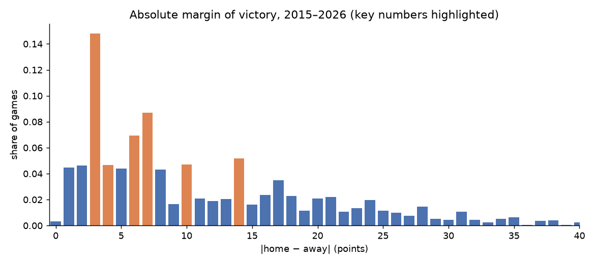

Home teams won 54.8% of games; ties occurred in 0.33%. The absolute margin lands exactly on 3 in **14.8%** of games and on 7 in 8.7%. A normal distribution centred on each game's closing spread with Stern's σ = 13.86 puts about 5.1% on each of those integers, so the market-relevant strikes are exactly where the normal is worst:

| \|margin\| | empirical | normal(spread, 13.86) | ratio |
|---|---|---|---|
| 1 | 4.5% | 5.1% | 0.88 |
| 2 | 4.6% | 5.1% | 0.90 |
| **3** | **14.8%** | 5.1% | **2.87** |
| 4 | 4.6% | 5.3% | 0.87 |
| 5 | 4.4% | 5.1% | 0.87 |
| **6** | **6.9%** | 4.8% | 1.46 |
| **7** | **8.7%** | 4.7% | 1.86 |
| 10 | 4.7% | 4.2% | 1.12 |
| **14** | **5.2%** | 3.5% | 1.47 |

Consequence for pricing: a spread contract at strike 2.5 vs 3.5 differs by ~15 percentage points of probability, three times what a smooth model implies. Any model used to price Kalshi spread ladders has to be discrete and key-number aware; this is the first thing to get right.

### 1.2 The closing spread is unbiased and slightly tighter than Stern's σ

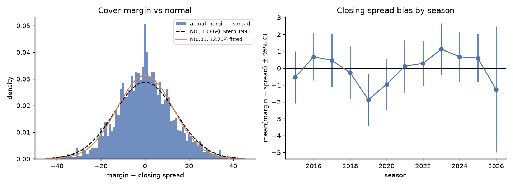

`margin − closing spread` has mean +0.03 and SD **12.73** over 2015–2026 (Stern's 1991 estimate was 13.86). No season's mean is significantly different from zero. The residual is fatter in the centre and thinner in the shoulders than a normal, again because of the spike at ±3.

### 1.3 Totals

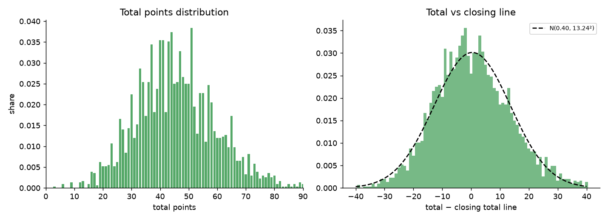

Mean total 45.7, SD 13.9. `total − closing total line` has mean +0.40 and SD 13.24, and the season means move (49.5 in 2020, 43.8 in 2023), so totals need a season-level drift term that the spread residual does not.

### 1.4 Joint structure: nearly uncorrelated but not independent

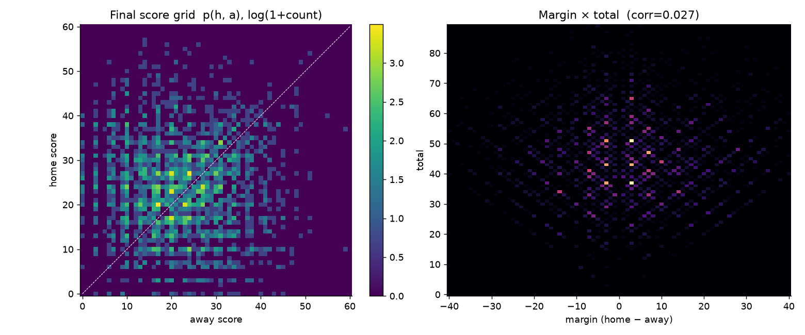

* Pearson correlation between margin and total: **0.027**; between |margin| and total: 0.034; between spread residual and total residual: 0.026. Linear dependence is negligible.
* Parity: margin and total have the same parity in **100%** of games (they are `h−a` and `h+a`). Half the (margin, total) lattice is structurally empty, and a Gaussian copula on the two marginals would put mass there.
* The score grid is dominated by a few cells: 20–17, 27–24, 23–20, 27–20 each account for about 1% of all games; the top 15 cells hold ~10% of mass.
* Conditional on total quartile, the SD of the margin rises from 12.9 (lowest-scoring quartile) to 14.9 (highest), so higher totals widen the margin distribution modestly.

Modelling implication: build `p(h, a)` directly on the integer grid rather than combining marginals. An empirical score table reweighted to match a game's spread and total (minimum relative entropy) preserves key numbers, parity and the conditional widening for free.

### 1.5 How good is the sportsbook closing line?

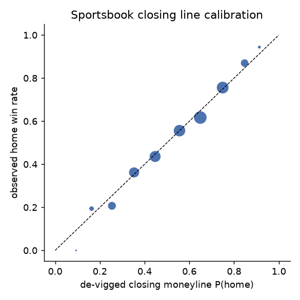

De-vigged closing moneylines are well calibrated across the range (average overround 3.1%). Brier score 0.2119, log-loss 0.6134. The Stern normal from the spread alone scores 0.2125, essentially identical: the win probability is nearly all in the spread, and the spread ladder is where the model has to earn its keep.

## 2. Kalshi NFL game markets, 2026 season

### 2.1 What is listed

| | winner | spread | total |
|---|---|---|---|
| markets | 256 | 2,930 | 2,216 |
| strikes per game | 2 (one per team) | 26 (24–33) | 20 (19–29) |
| trades | 8.18M | 2.89M | 1.84M |
| contracts | 1.43B | 344M | 202M |
| in-play share of contracts | **82%** | 57% | 62% |

354 events; 128 distinct games of which 79 are regular season (49 preseason games are not in nflverse and are excluded from all price comparisons). Spread strikes are half-points from ±1.5 to about ±30 with a separate market per team (`KC wins by over 6.5`), so a game's ladder gives `P(margin > k)` at ~13 strikes on each side. Totals are half-point strikes across roughly ±20 points around the line. Winner markets settle at $0.50 on a tie.

### 2.2 Volume and timing

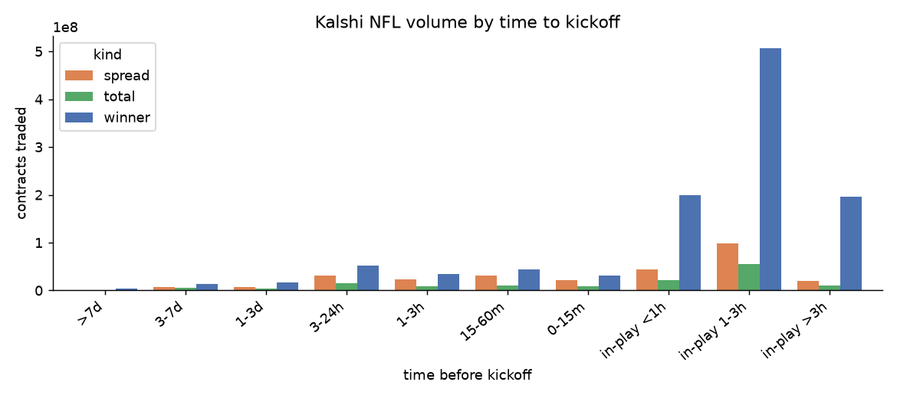

Regular-season games traded a median of 10M contracts (mean 19M) across the three market types; a marquee game (LAR–DEN, PHI–CHI) does 75M in the winner market alone. Volume is heavily in-play: 82% of winner contracts trade after kickoff, and the busiest bucket is 1–3 hours into the game. Pre-game liquidity is concentrated in the last 24 hours. Two consequences for the project:

* The pre-kickoff price is well defined (thousands of trades in the last hour), so a pre-game distribution can be calibrated to the market.
* The economically important pricing problem is in-play. A static pre-game model prices 18% of winner volume.

### 2.3 Calibration of pre-kickoff prices

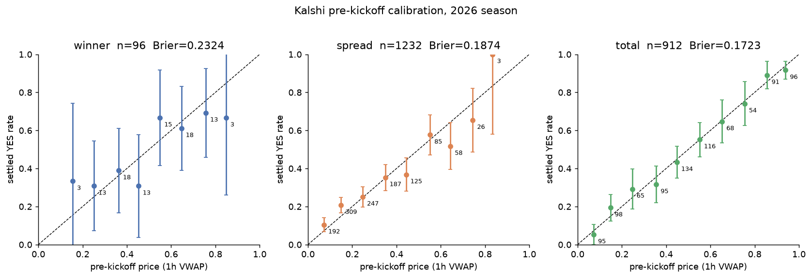

Prices are the contract-weighted average of trades in the hour before kickoff. Settled YES rate against price:

| market | n | Brier | log-loss |
|---|---|---|---|
| winner | 96 | 0.2324 | 0.660 |
| spread strikes | 1,232 | 0.1874 | 0.559 |
| total strikes | 912 | 0.1723 | 0.515 |

Spread and total ladders sit on the diagonal within sampling error at every price bucket. The winner panel is 48 games and its confidence intervals span the diagonal. Returns to buying YES by price bucket are noisy and, with only three weeks of outcomes, give no reliable evidence for or against a favourite–longshot bias; the low-price buckets (< 0.25) show positive returns but on 881 mostly correlated ladder-tail contracts from 48 games. Re-check once the season has 10+ weeks.

### 2.4 Kalshi winner price versus the sportsbook closing moneyline

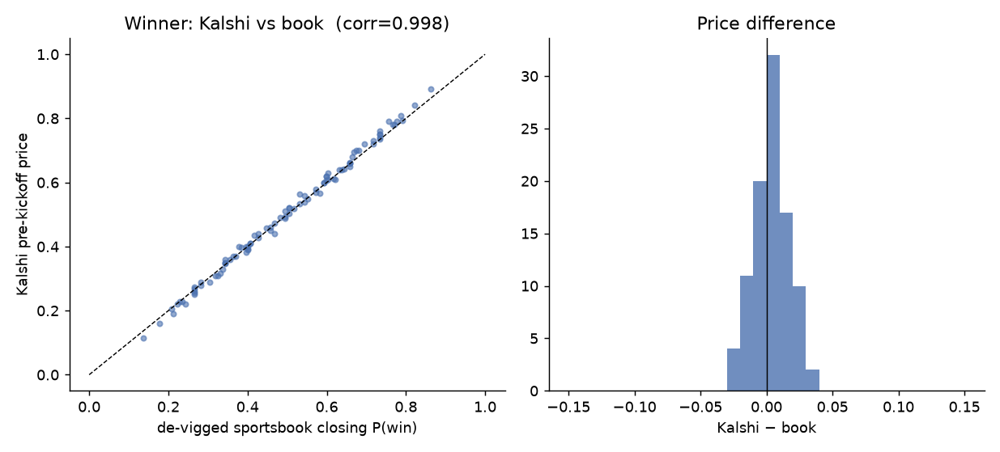

Across 96 team-markets the Kalshi 1h pre-kickoff price and the de-vigged consensus closing moneyline have correlation **0.998**, mean difference +0.4 pp, mean absolute difference **1.1 pp**. The sum of the two teams' YES prices per game averages 1.008 (sd 0.0035), so Kalshi's effective overround at the mid-tape is under 1% against 3.1% at the books. Brier scores on these 48 games: Kalshi 0.2324, book 0.2327, Stern normal from the closing spread 0.2286. The three are indistinguishable at this sample size; the market is efficient relative to the book at the moneyline level.

### 2.5 The spread and total ladders as market-implied distributions

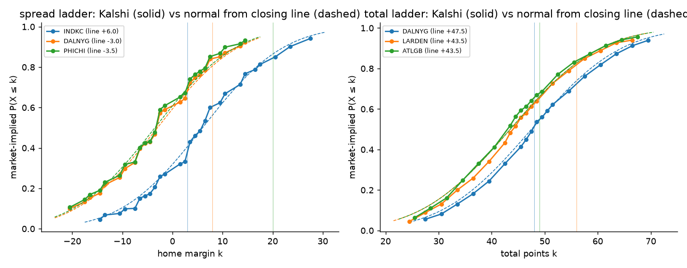

Converting each strike to `P(home margin ≤ k)` or `P(total ≤ k)` gives a market-implied CDF per game. In 96 spread ladders and 96 total ladders there are **zero** monotonicity violations larger than 2 cents at the pre-kickoff VWAP: the ladders are internally arbitrage-free at mid.

Against a normal centred on the closing line (σ = 12.73 for spreads, 13.24 for totals), the mean absolute CDF error is 2.3 pp for spreads and 1.3 pp for totals. It is largest for spreads within 7 points of the line (about 3 pp) and shrinks to 1.4 pp in the tails, which is where the normal's smoothness costs the most.

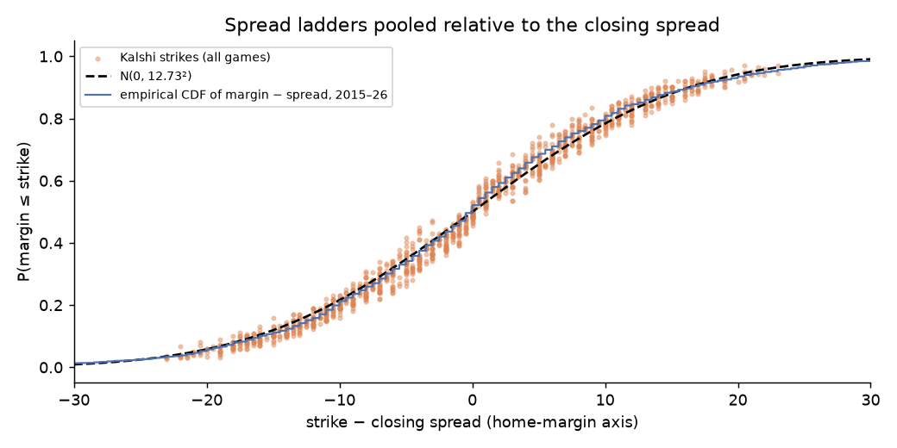

Pooling all spread strikes relative to the closing spread, the market-implied CDF tracks the 2015–2026 empirical step function, including the flat-then-jump shape around the key numbers, rather than the smooth normal. Reading the implied mass on integer margins from adjacent strikes:

| \|margin\| | market-implied (both sides) | empirical 2015–26 | normal |
|---|---|---|---|
| 3 | 15.3% | 14.8% | 5.1% |
| 7 | 10.8% | 8.7% | 4.7% |
| 10 | 6.2% | 4.7% | 4.2% |
| 14 | 6.0% | 5.2% | 3.5% |
| 2 | 3.6% | 4.6% | 5.1% |
| 5 | 3.2% | 4.4% | 5.1% |

The market prices the 3-point spike almost exactly at its historical frequency and puts somewhat more mass than history on 7, 10 and 14 while thinning the non-key integers. So the Kalshi spread ladder is a discrete, key-number-aware distribution already; a pricing model that ignores key numbers will disagree with the market by 5–10 pp on strikes near the line and lose to it.

### 2.6 In-play prices

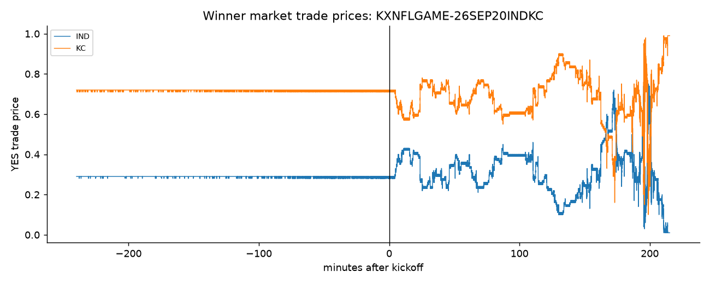

IND–KC, week 2: the pre-game tape is flat at 0.71/0.29 for hours, then moves in jumps after kickoff. Both sides trade continuously, and the two prices sum to about 1 throughout. This is the data for the in-play stage: each trade timestamp can be joined to nflverse play-by-play to get (score, clock, possession) and test a conditional score model against the market path.

### 2.7 Quoted spreads, open interest and price volatility (hourly candlesticks)

The authenticated candlestick endpoint gives, for every market and every hour it was listed, the trade OHLC, the best yes bid and ask at the hour's close, the hour's volume and the open interest. This is the first look at the cost of getting in and out, which the trade tape alone cannot show.

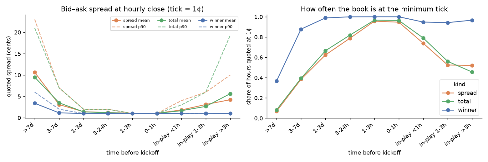

Tick size is 1¢, and the book sits at the minimum tick for most of the liquid window, so the median spread is uninformative; the mean, the 90th percentile and the share of hours at 1¢ carry the information.

| time to kickoff | winner mean (¢) | spread mean (¢) | total mean (¢) | share at 1¢: winner / spread / total |
|---|---|---|---|---|
| > 7 days | 3.4 | 10.6 | 9.5 | 37% / 7% / 8% |
| 3–7 days | 1.2 | 3.1 | 3.5 | 88% / 38% / 39% |
| 1–3 days | 1.0 | 1.4 | 1.4 | 99% / 62% / 67% |
| 3–24 h | 1.0 | 1.2 | 1.2 | 100% / 79% / 82% |
| 0–3 h | 1.0 | 1.0 | 1.0 | 100% / 95% / 96% |
| in-play, first hour | 1.1 | 1.8 | 1.7 | 95% / 74% / 79% |
| in-play, 1–3 h | 1.1 | 3.1 | 2.7 | 94% / 53% / 56% |

Three regimes:

* **Early listing (more than 3 days out):** wide, patchy books. Spread and total strikes average 10¢ with a 90th percentile above 20¢; only the winner market is reliably quoted.
* **Game day through kickoff:** essentially one tick everywhere. The winner market is at 1¢ in 100% of hours from 24 h out; the ladders reach 95% at 1¢ in the last three hours. Pre-game liquidity provision is competitive and the mid is a clean price.
* **In-play:** the winner market stays at ~1¢, but ladder spreads widen back to 2–3¢ on average with a 90th percentile of 6–19¢ late in the game as strikes go deep in or out of the money. In-play quoting risk is concentrated in the spread and total ladders, not the winner market.

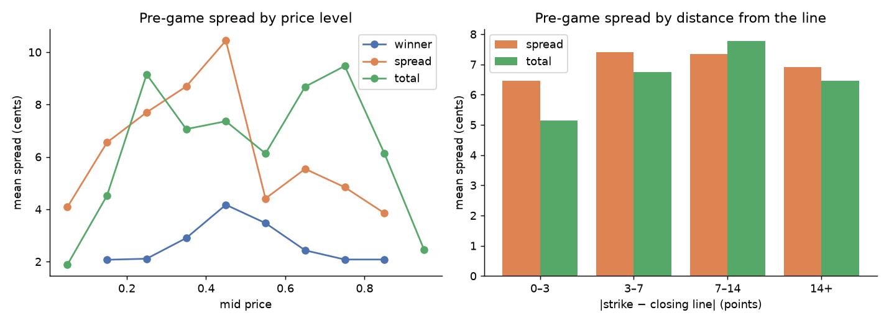

Pre-game spreads peak near 50¢ mids (winner 4.2¢, spread strikes 10.4¢ at the 40–50¢ bin) and are tightest at the extremes, the opposite of what a fixed-cents-per-contract model would give and consistent with market makers charging for variance (p(1−p)) rather than notional. Spreads on ladder strikes barely depend on distance from the closing line (6.5–7.8¢ in every bin), so the moneyness effect is a price-level effect, not a strike effect.

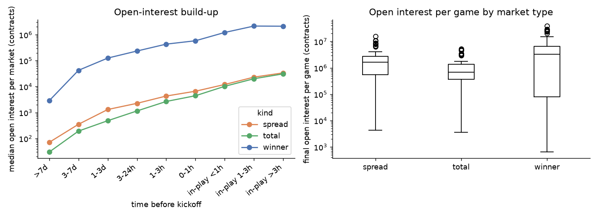

Open interest builds roughly geometrically toward kickoff and keeps growing in-play: the median winner market goes from 3k contracts a week out to 580k at kickoff and 2.1M three hours in. Final open interest per regular-season game (79 games): median 3.3M winner, 1.6M spread, 0.67M total contracts, 5.4M in total, with a maximum of 60M. At $1 notional per contract, the largest games carry tens of millions of dollars of open exposure into the final minutes.

Hourly changes in the mid quantify what "jump risk" means here:

| market | pre-game σ of hourly mid change | in-play σ |
|---|---|---|
| winner | 0.9¢ | 17.4¢ |
| spread strike | 2.0¢ | 18.4¢ |
| total strike | 2.1¢ | 15.4¢ |

A one-hour hold in-play carries roughly 20× the price variance of a one-hour hold pre-game, against a spread that is only 1–3¢ wider. Spread cost is a rounding error next to in-play inventory risk; the risk framework's binding constraint is the exposure vector across the score grid, not liquidity.

Spread-adjusted outcome test: buying every contract at the last pre-game ask (rather than the mid) costs on average 1.0¢ for winners and 1.05¢ for ladder strikes. The Brier score at the mid is unchanged from the trade-VWAP version (winner 0.2321, spread 0.1871, total 0.1729).

## 3. What this means for the pricing model

1. **Build `p(h, a)` on the integer grid.** The margin's 2.9× spike at 3, exact parity between margin and total, and cell concentration (20–17, 27–24, …) all rule out a smooth bivariate model. Start with the 2015–2026 empirical score table (3,076 games) reweighted by minimum relative entropy to hit a target spread and total; it preserves key numbers and parity by construction.
2. **The market is the benchmark, not the sportsbook.** Kalshi's pre-kickoff mid is within 1 pp of the de-vigged book at the moneyline, its overround is under 1%, and its ladders are arbitrage-free. Fair value for a contract should be judged against the Kalshi ladder; the book line is useful mostly as the input that centres the distribution.
3. **The ladder identifies the marginals, not the joint.** Spread strikes pin `P(margin ≤ k)` at ~26 points and total strikes pin `P(total ≤ k)` at ~20 points per game, but nothing observable pins the dependence. The historical grid says linear correlation is ~0.03 with a modest widening of the margin at high totals; that structure has to come from the prior table, which is fine because it is stable across seasons.
4. **Totals need a season drift term.** Season mean totals range 43.6–49.5 while the spread residual is stationary; the total-line residual mean is +0.4 with a season-level component.
5. **Risk sits in-play, and it is inventory risk, not liquidity risk.** 82% of winner volume trades after kickoff, hourly mid moves are ~17¢ in-play against ~1¢ pre-game, while quoted spreads stay at 1–3¢. The same joint table conditioned on (score, time) gives the in-play prices and the exposure vector across the score grid. Next step on the risk side: join the trade tape to play-by-play and measure how the market's implied `p(h, a)` moves per scoring event.
6. **Liquidity cost is a price-level function.** Spreads scale with p(1−p), not with strike distance, so a liquidation-cost model can be a single curve in the mid price per market type, widened by a time-to-kickoff factor (roughly 10× at a week out, 1× on game day, 2–3× in-play for ladders).

### Open items

* **2025 season on Kalshi.** Archived: markets, trades and candlesticks return 404 with and without authentication. Only a third-party archive can fill it.
* **Fees.** Kalshi charges a taker fee that peaks near 50-cent prices; the calibration above is at traded prices before fees. Fold the fee schedule into fair-value comparisons.
* **Order-book depth.** Candlesticks give the best bid and ask but not resting size. Depth beyond the touch is only available live via the authenticated order-book endpoint; a snapshotter should run during game windows to build it up.
* **Sample size.** All Kalshi statistics are from 48 regular-season games. Re-run `scripts/eda_kalshi.py` weekly; everything is cached and incremental.
