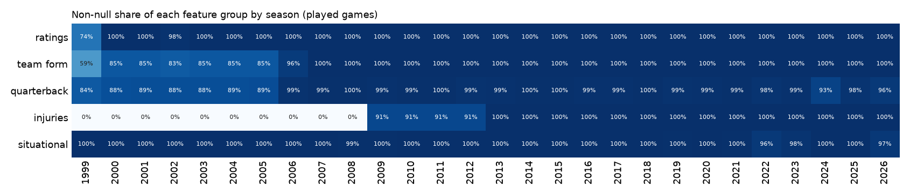
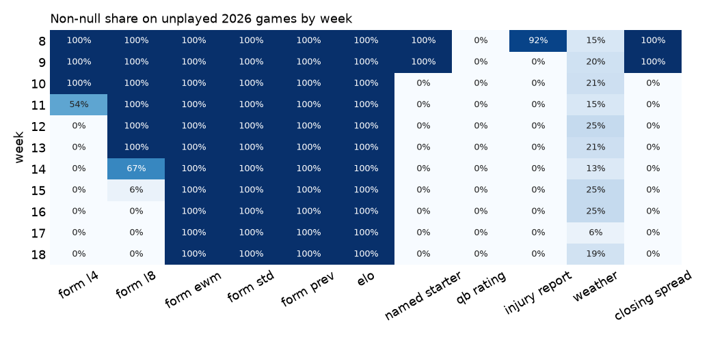
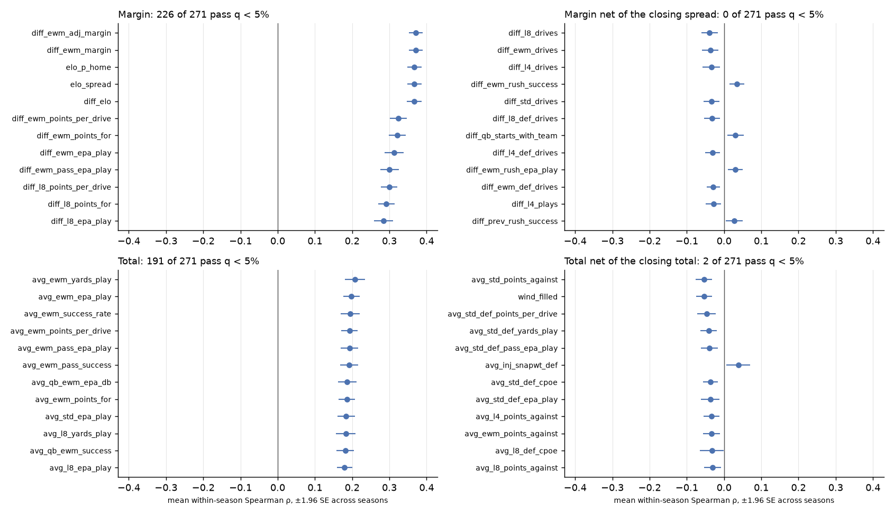
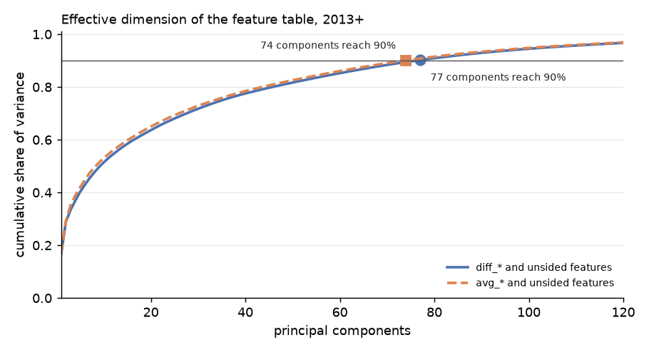
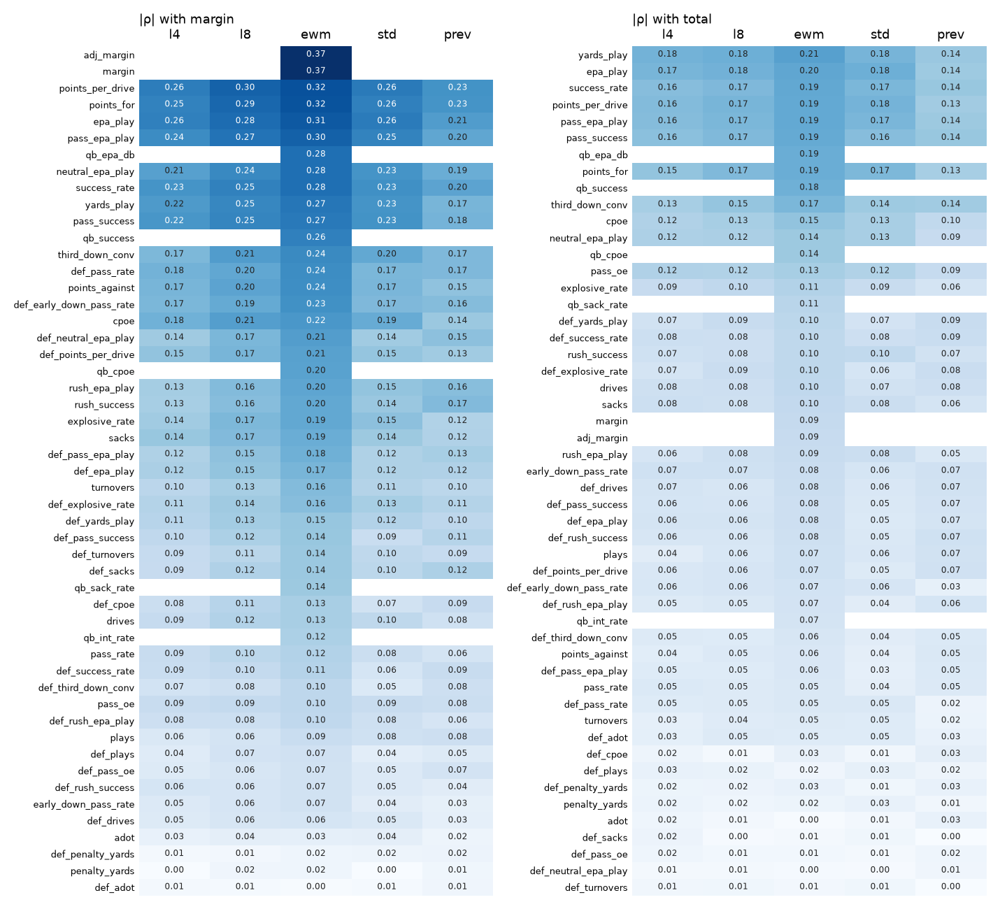
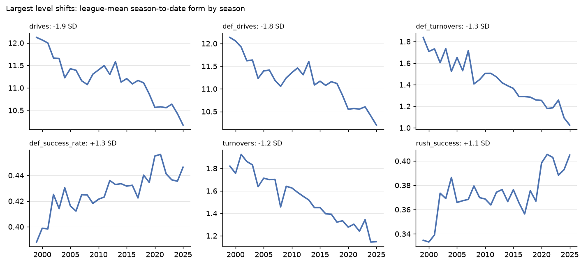
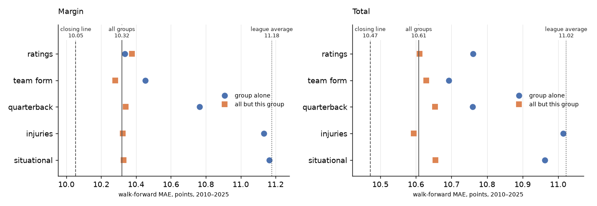

# Analysis of the pre-game feature table

*Generated by `scripts/analyze_features.py`; do not edit by hand. 7,548 games (7,384 played, 164 unplayed), 802 columns, 1999–2026. Analysed as 527 matchup features: `diff_x` and `avg_x` for each home/away pair, plus unsided ones.*

## A. Integrity

17 of 26 checks pass; warnings: 8, failures: 1.

| status | check | n_bad | detail |
|---|---|---|---|
| warn | home_win is 0.5 on a tie | 16 | coded [0.0]; winner contracts pay 0.5 |
| warn | overround not negative | 1 | 2020_01_LV_CAR |
| warn | weather plausible (wind <= 40 mph, temp in -30..120 F) | 3 | 2008_02_TEN_CIN, 2016_13_NYG_PIT, 2023_13_SF_PHI |
| warn | external ids are not numeric | 3 | gsis, pff, ftn pass an is_numeric_dtype feature filter |
| warn | rolling windows stay populated on unplayed games | 2 | l4 null on 70% of unplayed games; l8 null on 41% of unplayed games |
| fail | a starter with prior dropbacks keeps that history | 111 | career_dropbacks = 0 on 56 unplayed and 55 played team-games, e.g. 2026_09_TB_CHI, 2026_09_BUF_MIN, 2026_09_BUF_MIN; the merge in qb_features needs a row for this game |
| warn | QB experience is null when no starter is named | 136 | 0 reads as a debut; e.g. 2026_10_WAS_NYG, 2026_10_NE_DET, 2026_10_JAX_TEN |
| warn | injury counts are null when no report exists | 152 | no report yet is stored as 0 injured on unplayed games; e.g. 2026_08_CHI_SEA, 2026_09_JAX_BAL, 2026_09_CIN_ATL |
| warn | feature dictionary files ids under identifiers | 8 | gsis, pff, ftn, old_game_id, nfl_detail_id |

Checks passed: game_id unique; game_id matches season, week and teams; at most one game per team and week; franchise codes follow relocations; targets all present or all absent; margin = home_score - away_score; total_pts = home_score + away_score; no unplayed game before the last played one; diff_x = home_x - away_x (228 pairs); elo_diff = home_elo + home field - away_elo; no infinite values; no constant columns; probabilities in [0, 1]; spread_line positive when the home team is favoured; no feature has |rho| > 0.6 with its own game's score; rolling form is null in a team's first game; feature dictionary lists exactly the table's columns.

## B. Coverage

Unplayed games, by week:

A window is computed over a team's row sequence, including unplayed rows, so `l4` and `l8` empty out as the horizon grows. `ewm`, `std` and `prev` hold the last known value. `injury report` counts games with at least one non-zero count, because an absent report is stored as zeros.

## C. Signal

Mean within-season Spearman ρ, t across seasons, Benjamini-Hochberg q across the features tested. Margin targets use `diff_*`, total targets `avg_*`; unsided features enter both. Net-of-line targets ask whether a feature knows something the close does not; there are no costs here and a correlation is not a bet.

**Margin**: 226 of 271 features pass q < 5%.

| feature | n_seasons | rho_mean | rho_se | t | q | same_sign | rho_early | rho_late |
|---|---|---|---|---|---|---|---|---|
| diff_ewm_adj_margin | 28 | 0.371 | 0.010 | 38.812 | 0.000 | 1.000 | 0.371 | 0.371 |
| diff_ewm_margin | 28 | 0.371 | 0.009 | 39.184 | 0.000 | 1.000 | 0.367 | 0.375 |
| elo_p_home | 28 | 0.367 | 0.010 | 38.227 | 0.000 | 1.000 | 0.365 | 0.370 |
| elo_spread | 28 | 0.367 | 0.010 | 38.227 | 0.000 | 1.000 | 0.365 | 0.370 |
| diff_elo | 28 | 0.367 | 0.010 | 37.005 | 0.000 | 1.000 | 0.364 | 0.369 |
| diff_ewm_points_per_drive | 28 | 0.324 | 0.012 | 27.320 | 0.000 | 1.000 | 0.317 | 0.331 |
| diff_ewm_points_for | 28 | 0.321 | 0.012 | 27.508 | 0.000 | 1.000 | 0.315 | 0.327 |
| diff_ewm_epa_play | 28 | 0.313 | 0.013 | 23.905 | 0.000 | 1.000 | 0.307 | 0.318 |

**Margin net of the closing spread**: 0 of 271 features pass q < 5%.

| feature | n_seasons | rho_mean | rho_se | t | q | same_sign | rho_early | rho_late |
|---|---|---|---|---|---|---|---|---|
| diff_l8_drives | 28 | -0.039 | 0.011 | -3.509 | 0.178 | 0.786 | -0.034 | -0.044 |
| diff_ewm_drives | 28 | -0.037 | 0.011 | -3.299 | 0.178 | 0.750 | -0.029 | -0.045 |
| diff_l4_drives | 28 | -0.034 | 0.012 | -2.902 | 0.180 | 0.679 | -0.032 | -0.037 |
| diff_ewm_rush_success | 28 | 0.034 | 0.010 | 3.368 | 0.178 | 0.786 | 0.035 | 0.034 |
| diff_std_drives | 28 | -0.034 | 0.011 | -3.055 | 0.178 | 0.679 | -0.024 | -0.043 |
| diff_l8_def_drives | 28 | -0.033 | 0.011 | -3.014 | 0.178 | 0.714 | -0.030 | -0.036 |
| diff_qb_starts_with_team | 28 | 0.031 | 0.011 | 2.760 | 0.203 | 0.679 | 0.032 | 0.030 |
| diff_l4_def_drives | 28 | -0.031 | 0.010 | -3.037 | 0.178 | 0.607 | -0.032 | -0.029 |

**Total**: 191 of 271 features pass q < 5%.

| feature | n_seasons | rho_mean | rho_se | t | q | same_sign | rho_early | rho_late |
|---|---|---|---|---|---|---|---|---|
| avg_ewm_yards_play | 28 | 0.208 | 0.014 | 14.810 | 0.000 | 1.000 | 0.243 | 0.172 |
| avg_ewm_epa_play | 28 | 0.198 | 0.012 | 17.203 | 0.000 | 1.000 | 0.219 | 0.177 |
| avg_ewm_success_rate | 28 | 0.194 | 0.013 | 14.826 | 0.000 | 1.000 | 0.219 | 0.169 |
| avg_ewm_points_per_drive | 28 | 0.193 | 0.011 | 17.193 | 0.000 | 1.000 | 0.216 | 0.171 |
| avg_ewm_pass_epa_play | 28 | 0.193 | 0.012 | 15.929 | 0.000 | 1.000 | 0.215 | 0.171 |
| avg_ewm_pass_success | 28 | 0.192 | 0.012 | 15.770 | 0.000 | 1.000 | 0.214 | 0.170 |
| avg_qb_ewm_epa_db | 28 | 0.187 | 0.013 | 14.749 | 0.000 | 1.000 | 0.201 | 0.173 |
| avg_ewm_points_for | 28 | 0.186 | 0.011 | 16.254 | 0.000 | 1.000 | 0.204 | 0.168 |

**Total net of the closing total**: 2 of 271 features pass q < 5%.

| feature | n_seasons | rho_mean | rho_se | t | q | same_sign | rho_early | rho_late |
|---|---|---|---|---|---|---|---|---|
| avg_std_points_against | 28 | -0.054 | 0.011 | -4.707 | 0.009 | 0.857 | -0.057 | -0.051 |
| wind_filled | 28 | -0.054 | 0.011 | -5.054 | 0.007 | 0.750 | -0.041 | -0.066 |
| avg_std_def_points_per_drive | 28 | -0.047 | 0.013 | -3.673 | 0.074 | 0.786 | -0.047 | -0.047 |
| avg_std_def_yards_play | 28 | -0.041 | 0.011 | -3.655 | 0.074 | 0.750 | -0.026 | -0.056 |
| avg_std_def_pass_epa_play | 28 | -0.039 | 0.012 | -3.302 | 0.122 | 0.750 | -0.028 | -0.050 |
| avg_inj_snapwt_def | 14 | 0.039 | 0.016 | 2.355 | 0.497 | 0.643 | 0.006 | 0.071 |
| avg_std_def_cpoe | 21 | -0.037 | 0.010 | -3.659 | 0.085 | 0.810 | -0.034 | -0.040 |
| avg_std_def_epa_play | 28 | -0.037 | 0.013 | -2.862 | 0.223 | 0.750 | -0.027 | -0.047 |

## D. Redundancy

* `diff_*` and unsided, 2013+: 271 features fall into 169 clusters at |r| ≥ 0.8; 77 principal components reach 90% of variance, 104 reach 95%.
* `avg_*` and unsided, 2013+: 271 features fall into 166 clusters at |r| ≥ 0.8; 74 principal components reach 90% of variance, 102 reach 95%.

Largest `diff_*` clusters, named by the member most correlated with the margin:

| feature | cluster_size | rho |
|---|---|---|
| diff_ewm_points_per_drive | 8 | 0.324 |
| diff_prev_points_per_drive | 7 | 0.230 |
| diff_ewm_adj_margin | 5 | 0.371 |
| diff_std_points_per_drive | 4 | 0.264 |
| diff_ewm_success_rate | 4 | 0.280 |
| diff_l4_points_per_drive | 4 | 0.260 |
| diff_ewm_drives | 4 | -0.127 |
| diff_ewm_pass_oe | 4 | 0.102 |
| diff_ewm_pass_rate | 4 | -0.115 |
| diff_prev_points_against | 4 | -0.152 |

Full list, with a representative per cluster: `data/processed/features_analysis_clusters_{diff,avg}.csv`.

Windows compared:

Strongest window per statistic: margin: ewm 48, prev 2, l8 1; total: ewm 42, prev 3, std 3, l4 2, l8 1.

## E. Drift

`diff_*` is close to level-free by construction; level shifts land in `avg_*`, and so in the total. A model fitted on old seasons inherits them.

| feature | eta2 | first_mean | last_mean | shift_sd |
|---|---|---|---|---|
| avg_ewm_def_drives | 0.597 | 11.880 | 10.491 | -2.286 |
| avg_ewm_drives | 0.588 | 11.880 | 10.492 | -2.269 |
| avg_prev_def_drives | 0.560 | 11.815 | 10.521 | -2.140 |
| avg_prev_drives | 0.553 | 11.817 | 10.524 | -2.125 |
| avg_l8_def_drives | 0.475 | 11.852 | 10.474 | -2.006 |
| avg_l8_drives | 0.471 | 11.851 | 10.475 | -1.996 |
| avg_std_drives | 0.400 | 11.901 | 10.474 | -1.854 |
| avg_std_def_drives | 0.400 | 11.874 | 10.466 | -1.850 |
| avg_ewm_def_turnovers | 0.400 | 1.753 | 1.210 | -1.707 |
| avg_l4_def_drives | 0.350 | 11.840 | 10.464 | -1.701 |

## F. Value of each group

Ridge as in `scripts/baseline_models.py`, trained on seasons < t from 2000, tested on t in 2010–2025. `diff_vs_all` > 0 means the model errs by more than all-groups. Standard errors are of the paired difference, clustered by week and by season.

**Margin** (4,363 games)

| model | mae | diff_vs_all | se_week | se_season | t_week |
|---|---|---|---|---|---|
| all groups | 10.318 | 0.000 |  |  |  |
| ratings only | 10.335 | 0.017 | 0.034 | 0.028 | 0.502 |
| all minus ratings | 10.377 | 0.059 | 0.016 | 0.014 | 3.604 |
| team form only | 10.454 | 0.135 | 0.028 | 0.027 | 4.760 |
| all minus team form | 10.281 | -0.037 | 0.023 | 0.022 | -1.587 |
| quarterback only | 10.763 | 0.445 | 0.063 | 0.062 | 7.072 |
| all minus quarterback | 10.340 | 0.021 | 0.016 | 0.016 | 1.326 |
| injuries only | 11.134 | 0.815 | 0.077 | 0.061 | 10.598 |
| all minus injuries | 10.324 | 0.006 | 0.013 | 0.012 | 0.422 |
| situational only | 11.163 | 0.845 | 0.079 | 0.066 | 10.753 |
| all minus situational | 10.330 | 0.011 | 0.011 | 0.009 | 1.054 |
| league average | 11.178 | 0.860 | 0.080 | 0.066 | 10.760 |
| closing line | 10.054 | -0.264 | 0.041 | 0.033 | -6.427 |

**Total** (4,363 games)

| model | mae | diff_vs_all | se_week | se_season | t_week |
|---|---|---|---|---|---|
| all groups | 10.608 | 0.000 |  |  |  |
| ratings only | 10.761 | 0.153 | 0.032 | 0.032 | 4.726 |
| all minus ratings | 10.610 | 0.002 | 0.007 | 0.006 | 0.317 |
| team form only | 10.693 | 0.085 | 0.018 | 0.018 | 4.660 |
| all minus team form | 10.630 | 0.022 | 0.025 | 0.026 | 0.848 |
| quarterback only | 10.759 | 0.151 | 0.044 | 0.063 | 3.466 |
| all minus quarterback | 10.653 | 0.045 | 0.009 | 0.011 | 4.854 |
| injuries only | 11.014 | 0.406 | 0.056 | 0.056 | 7.246 |
| all minus injuries | 10.594 | -0.014 | 0.008 | 0.007 | -1.864 |
| situational only | 10.962 | 0.354 | 0.059 | 0.068 | 6.041 |
| all minus situational | 10.655 | 0.047 | 0.012 | 0.011 | 3.900 |
| league average | 11.023 | 0.415 | 0.059 | 0.066 | 6.973 |
| closing line | 10.471 | -0.137 | 0.035 | 0.036 | -3.878 |
