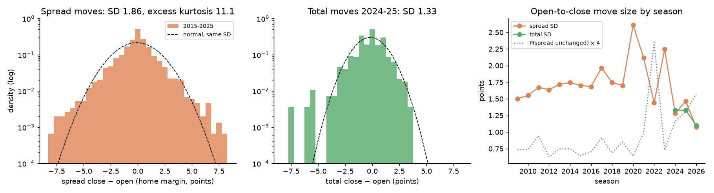
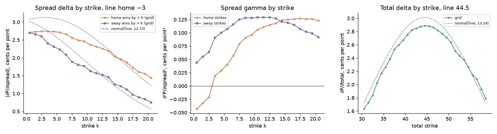
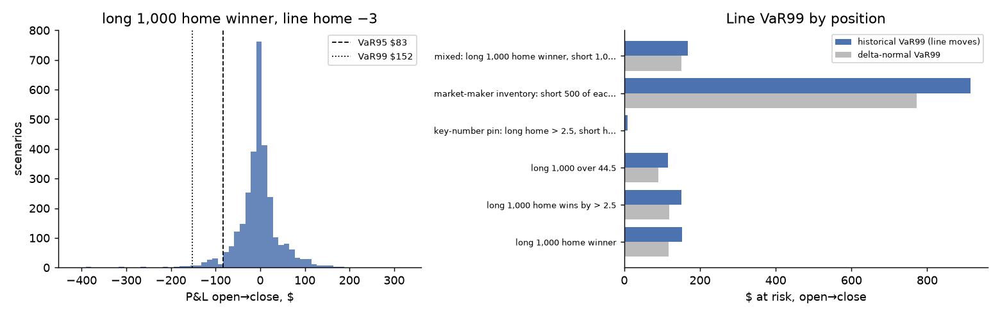
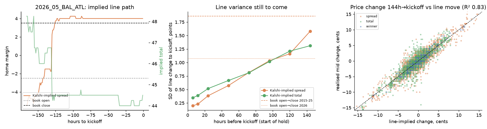
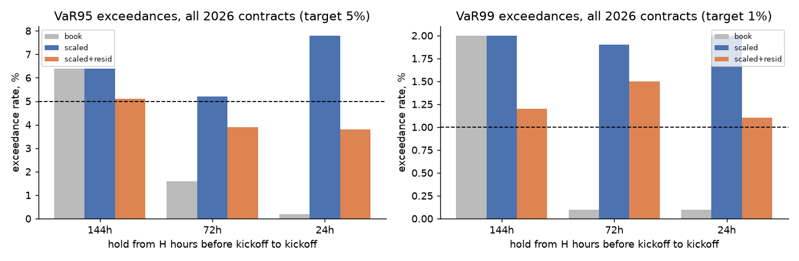

# Pre-game line risk: Greeks, line moves and VaR for Kalshi NFL positions

*Reproduce with `python scripts/line_var.py` in the `nfl` environment (about 40 s; `--refresh` rebuilds the price lattice, `--no-backtest` skips section 4). Data: nfelo game file (sportsbook opening and closing lines), nflverse schedules, and Kalshi hourly candles pulled 2026-10-21 (2026 regular season, weeks 1–7). Code: `src/pmrisk/risk.py`.*

## Idea

Before kickoff, every Kalshi winner, spread and total contract on a game is, to first order, a function of two state variables: the market's spread `s` (expected home margin) and total `t`. The score grid tilted to `(s, t)` gives that function, so the contracts are derivatives on the line:

- **Greeks** are the sensitivities of each contract to `s` and `t`.
- **Line risk** is the distribution of moves in `(s, t)` between now and kickoff.
- **VaR** is that distribution pushed through full revaluation of the position.

Settlement risk, meaning what the final score does to a position held to the whistle, is a separate quantity. The same grid gives it directly.

## 1. How much do lines move? (nfelo, open → close)

| | n | SD | P(unchanged) | P(\|Δ\| ≥ 3) | excess kurtosis | 1% / 99% |
|---|---|---|---|---|---|---|
| spread, 2015–2025 | 3,028 | **1.86** | 25% | 10.6% | **11.1** | −5.5 / +5.0 |
| spread, 2009–2025 | 4,630 | 1.79 | 23% | 10.2% | 8.8 | −5.0 / +4.5 |
| total, 2024–2025 | 557 | 1.33 | 25% | 5.0% | 3.0 | −4.0 / +2.7 |



* **Spread moves are very fat-tailed.** Most games move 0–1 points; a tenth move 3 or more. The large moves are discrete news: QB status, other key injuries, weather.
* **Totals move less** and with thinner tails. nfelo has total opening lines only from 2024.
* **Signed spread and total moves are almost independent** (correlation 0.08). Their sizes correlate a little more (0.17): the same news moves both. The VaR therefore pairs every 2015–2025 spread move with a total move drawn from 2024–2025. The joint 2024–2025 pairs are kept as a check.
* **Move size varies by season.** It peaks in 2020 (SD 2.6, the COVID season) and is smaller in 2024–2026 (1.1–1.5). The share of unchanged lines jumps to 59% in 2022, which looks like a change in nfelo's opening-line source rather than in the market.
* **Pick'em games move most** (SD 2.1, against 1.6 for lines of 3–5.5).

**Data fix.** nfelo writes the Raiders as OAK and the Rams as LAR in every season. A plain `game_id` merge with nflverse therefore drops about 12% of games from 2015 on. `pmrisk.nfl.nfelo_game_id` maps them, and the match rate is now 100% for 2015–2026. `scripts/ensemble_external.py` now uses it too; its common sample grows from 3,168 to 3,562 games.

## 2. Greeks from the score grid

The tilted grid is an exponential family in the tilt parameters λ, with sufficient statistic T = (margin, total). Because the tilt is fitted so that E[T] = (s, t), the chain rule gives an exact delta for any payoff f, with no re-tilting:

```
(∂P/∂s, ∂P/∂t) = Cov(f, T) · Cov(T)⁻¹
```

This matches finite differences to five decimals. Gammas are central differences of this delta.



**Example game:** home favoured by 3, total 44.5 (`data/processed/line_var_greeks_example.csv`).

| contract | price | ∂P/∂spread (¢/pt) | ∂P/∂total (¢/pt) | normal model ∂P/∂spread |
|---|---|---|---|---|
| home winner | 58.0 | 2.71 | −0.04 | 3.07 |
| home wins by > 2.5 | 53.3 | 2.74 | −0.05 | 3.13 |
| home wins by > 13.5 | 22.7 | 2.19 | 0.01 | 2.23 |
| away wins by > 3.5 | 30.7 | −2.40 | 0.01 | −2.75 |
| over 44.5 | 47.1 | −0.06 | 2.89 | 3.01 (in total) |

* **Delta is about 2.7¢ per point near the line**, roughly 12% below the normal model (3.1¢), and decays more slowly into the tails. Tilting reweights the grid rather than shifting it, so the empirical mass on 3 and 7 stays where it is. Key numbers show up as price gaps between adjacent strikes, not as spikes in a fixed strike's line delta.
* **Cross-sensitivities are negligible.** Spread contracts move less than 0.14¢ per point of total, so the two risk factors separate and the implied line can be fitted one axis at a time.
* **Gammas are small** (≤ 0.13¢ per point²). For moves of a few points the price is nearly linear in the line. The tails of the move distribution matter far more than convexity.

## 3. VaR of reference positions

Historical simulation uses 3,028 scenarios (2015–2025 spread moves, paired as above). Each scenario is revalued in full on a precomputed lattice of tilted grids: spread −24 to 24 and total 30 to 65, in 0.25-point steps, with bilinear interpolation between points. The example line is again home −3, total 44.5. All amounts are in dollars; each contract pays $1.

| position | value | Δ spread ($/pt) | VaR95 | VaR99 | ES99 | delta-normal VaR99 | settlement VaR95 |
|---|---|---|---|---|---|---|---|
| long 1,000 home winner | 580 | 27.1 | 83 | **152** | 226 | 117 | 580 |
| long 1,000 home > 2.5 | 534 | 27.4 | 83 | 150 | 220 | 119 | 534 |
| long 1,000 over 44.5 | 471 | 28.9 (total) | 73 | 116 | 158 | 89 | 471 |
| key-number pin: long home > 2.5, short home > 3.5 | 78 | 0.0 | 4 | 8 | 16 | 3 | 78 |
| short 500 of each home strike 0.5–13.5 | −2,628 | −178 | 463 | 914 | 1,179 | 772 | 4,372 |
| long 1,000 home winner, short 1,000 over | 109 | 27.6 / −29.3 | 99 | 168 | 235 | 151 | 1,109 |



* **Fat tails cost about 30% at 99%.** At 95% historical and delta-normal VaR agree; at 99% the historical figure is 1.2–1.3× larger.
* **The key-number pin has almost no line risk but full settlement risk.** It pays only if the home team wins by exactly 3. Its mark-to-market VaR is $8, but held to the whistle it loses its whole $78 premium about 92% of the time. Mark-to-market line VaR is the right number for a position that will be closed before kickoff. Anything held through the game needs the grid's payoff distribution, and the in-play risk on top of that.
* **The joint 2024–2025 scenario set gives lower VaR99** for spread positions (102 against 152), because recent seasons moved less. Which window to use is a modelling choice; the longer one is the conservative one.

## 4. Out-of-sample backtest on 2026 Kalshi games

**Sample.** 93 regular-season games from weeks 1–7 have candles, and 74–77 games have fit-able ladders at each horizon. That gives 3,100–3,400 contract observations per horizon. The scenario moves use 2015–2025 only.

**Kalshi-implied line.** For each game and hour, the lattice point `(s, t)` is chosen to best fit the two-sided mids by least squares. A quote is used if its bid-ask spread is ≤ 6¢ and its mid is between 3¢ and 97¢; at least 4 spread and 4 total strikes are required. Winner markets are used when quoted.
- The median fit RMSE is 2.0¢.
- In the last hour the Kalshi-implied spread is on average 0.48 points more home-favoured than the book close (MAE 0.98).
- The implied total is 0.61 above the book close on average and never below it.

The tilt matches the mean of the distribution, while book lines sit nearer the median; historically the realised total averages 0.4 above the closing line. The risk state should therefore be the Kalshi-implied line, not the book line plugged into the grid.



**How line variance accrues toward kickoff.** Each row is the SD of the Kalshi-implied line change from H hours out to kickoff, and the share of the 6-day variance that is still to come:

| H (hours before kickoff) | 144 | 120 | 96 | 72 | 48 | 24 | 6 |
|---|---|---|---|---|---|---|---|
| SD spread (pts) | 1.48 | 1.08 | 0.99 | 0.82 | 0.48 | 0.32 | 0.21 |
| spread variance still to come | 100% | 53% | 45% | 30% | 10% | 5% | 2% |
| SD total (pts) | 1.17 | 1.13 | 0.99 | 0.80 | 0.58 | 0.44 | 0.39 |
| total variance still to come | 100% | 95% | 72% | 47% | 24% | 14% | 11% |

* **Half the week's spread variance arrives in the first day the ladders trade**, 6 to 5 days out, as the market absorbs the previous week's results and injuries.
* **Totals move later** (weather forecasts) and keep 11% of their variance into the last 6 hours.
* **The 6-day Kalshi SD (1.48) sits between** the 2015–2025 book SD (1.86) and 2026's book SD (1.08).

**How much of the price change is the line?** At 144h, the change in the Kalshi-implied line explains R² = 0.80 of the variance in contract mid changes to kickoff:

| contract type | R² | residual SD |
|---|---|---|
| winner | 0.92 | 1.0¢ |
| spread | 0.83 | 1.5¢ |
| total | 0.72 | 1.7¢ |

The sportsbook's open→close move alone, which is independent data, explains R² = 0.56. The residual is shape change the two-parameter tilt does not capture.

**VaR coverage.** The test is long and short one contract, mid to mid, with the two tails averaged. Three VaR models:

* **book**: the 2015–2025 open→close scenarios, unscaled.
* **scaled**: the same scenarios scaled by the horizon curve above, leaving the tested game's week out.
* **scaled + resid**: scaled, plus a non-line residual drawn from other weeks' residuals of the same contract type and horizon.

| hold | book 95% | scaled 95% | **scaled + resid 95%** | book 99% | scaled 99% | **scaled + resid 99%** | mean VaR95 (scaled + resid) |
|---|---|---|---|---|---|---|---|
| 144h → kickoff | 6.0% | 6.0% | **4.8%** [2.9, 7.1] | 2.0% | 2.0% | **1.3%** | 6.2¢ |
| 72h → kickoff | 1.6% | 4.6% | **3.5%** [1.9, 5.5] | 0.2% | 1.6% | **1.2%** | 3.7¢ |
| 24h → kickoff | 0.1% | 8.5% | **4.0%** [2.9, 5.2] | 0.0% | 2.0% | **0.9%** | 2.0¢ |

The 95% intervals in brackets resample whole games, because contracts in the same game are correlated.



* **The book open→close history is the right VaR for a full-week hold.** Unscaled, it is calibrated at 144h, and adding the residual brings it to 4.8% and 1.3%.
* **Shorter holds need the horizon multiplier.** Without it, the unscaled VaR95 is 1.5× too large at 72h and 2.8× at 24h, and breaches only 1.6% and 0.1% of the time.
* **Close to kickoff the residual dominates.** By 24h, non-line shape noise is the larger part of the risk, and the line-only VaR under-covers (8.5%).
* **Totals are the weakest contract type.** At 144h the line-only model breaches 7.8% at 95%, and the residual term fixes it (5.9%).

## Caveats

* **Small sample.** There are seven weeks and 74–77 games, and the game-block intervals are wide.
* **Part of the calibration comes from 2026 itself.** The horizon multipliers and residual pools are estimated from 2026 (leave-one-week-out), while the scenario moves are 2015–2025. Re-estimate the multipliers each week as the season grows.
* **Mid to mid.** Liquidation cost is excluded; it is 1–3¢ pre-game, per `reports/eda.md` §2.7.
* **The 144h start is approximate.** It is where ladders become fit-able (about 80% of games), and is assumed to be about when the book opener is taken. nfelo does not timestamp its opening line.
* **Scenarios are unconditional.** A game with a QB listed as questionable should have a wider move distribution; conditioning on injury-report status is the natural next step.
* **Pre-game only.** In-play price variance is about 20× larger (`reports/eda.md` §2.7), and that risk needs the grid conditioned on game state.
* **Winner candles are truncated.** For winner markets listed months ahead, `scripts/pull_kalshi_candles.py` stores only a window that ends days before kickoff (for example, hours 207–331 out). The candlestick request appears to be capped and returns the earliest window. Spread and total ladders are unaffected, and the implied-line fit does not require the winner market.

## Using it

```python
import numpy as np, pandas as pd
from pmrisk.risk import Contract, PriceLattice, line_moves, scenario_pnl, var_es

lat = PriceLattice.load("data/processed/line_lattice.npz")        # built by scripts/line_var.py
mv = line_moves(pd.read_csv("data/raw/external/nfelo_games.csv", index_col=0))
mv = mv[mv.season.between(2015, 2025)]
d_spread = mv.d_spread.to_numpy()
d_total = np.random.default_rng(0).choice(mv.d_total.dropna().to_numpy(), len(d_spread))
k_s, k_t = np.sqrt(0.30), np.sqrt(0.47)        # 72h to kickoff: variance shares from line_var_horizon_curve.csv

book = [Contract("winner", "home", qty=1000), Contract("total", "over", 44.5, qty=-1000)]
s, t = 3.0, 44.5                                                     # Kalshi-implied line now
pnl = scenario_pnl(lat, book, s, t, k_s * d_spread, k_t * d_total)
var99, es99 = var_es(pnl, 0.99)      # for holds under ~3 days, add a residual draw (section 4)
```
