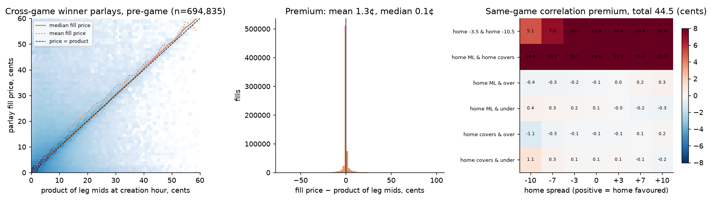
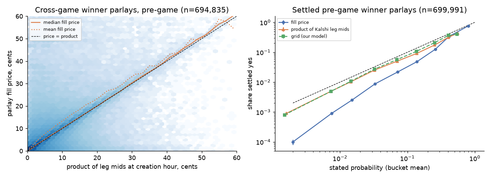
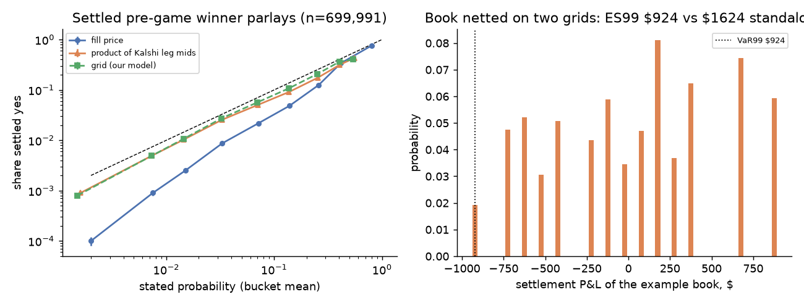

# Parlays: product of the legs, or the joint grid?

*Reproduce with `python scripts/pull_kalshi_parlays.py` (needs `.env` credentials) then `python scripts/parlay_analysis.py` in the `nfl` environment. Unit tests of the pricing module: `python -m pytest tests/test_parlay.py`. Data pulled 2026-10-28.*

## Idea

A parlay pays $1 only if every leg settles yes. If the legs are on different games and the games are independent, its fair price is the product of the legs' probabilities. If two legs are on the same game, the product is wrong by construction: "home wins" and "over 44.5" are two regions of the same score grid, and the parlay's probability is the grid's mass on their intersection. The joint distribution $p(h,a)$ that prices every single-game contract therefore prices same-game parlays too, and the gap between its joint probability and the product of the marginals is the **correlation premium**.

Three questions follow, in the order the data allows:

1. Across games, is independence right? (Residual correlations between games on the same slate.)
2. Within a game, how large is the correlation premium for the combinations people actually buy, and does the grid's dependence match history?
3. Does Kalshi price its parlays at the product of the leg prices, and do those prices settle at their stated probability?

## 1. Independence across games

The forest's out-of-sample residuals (2010–2025, 4,363 games) give a direct test: if games on the same day shared a common shock (weather, officiating, a scoring-environment factor), their residuals would be correlated. The pairwise correlation between all games on the same date, and between all games in the same week:

| residual | same date | same week |
|---|---|---|
| margin, forest | −0.005 (14,426 pairs, SE 0.008) | −0.005 (20,680 pairs, SE 0.007) |
| total, forest | −0.017 | −0.008 |
| margin vs closing spread | −0.008 | −0.009 |
| total vs closing total | −0.015 | −0.008 |

Every correlation is within two standard errors of zero and three of the four are slightly negative. The joint frequencies say the same: for two games in the same week, both home teams win 29.5% of the time against 30.0% from the product of the marginals, both cover 23.6% against 24.0%, both go over 23.9% against 23.9%. **Multiplying leg probabilities across games is the right rule.** The common scoring-environment factor noted in `line_var.md` lives in the season-level drift of totals, which the line already carries; it does not show up between games on the same day.

## 2. Same-game legs on the grid

The right-hand panel prices the standard two-leg combinations on the 2015–2025 grid tilted to each line (total 44.5; `data/processed/parlay_sgp_lattice.csv` has totals 40.5 and 49.5 too). Premium = joint probability − product of marginals, in cents:

| combination | home −10 | −7 | −3 | pick | +3 | +7 | +10 |
|---|---|---|---|---|---|---|---|
| home ML & over | −0.4 | −0.3 | −0.2 | −0.1 | 0.0 | +0.2 | +0.3 |
| home covers & over | −1.1 | −0.3 | −0.1 | −0.1 | −0.2 | +0.1 | +0.2 |
| home ML & home covers | 10.9 | 13.3 | 19.2 | 24.8 | 22.5 | 15.5 | 12.0 |
| home −3.5 & home −10.5 | 5.1 | 7.1 | 10.1 | 12.4 | 14.4 | 15.9 | 16.0 |

Two findings:

* **Winner-and-total and spread-and-total combinations are nearly independent.** The premium is under half a cent across the whole range of lines, with the sign the folklore predicts (a favourite winning goes with more scoring, so favourite-ML-and-over is slightly positive and dog-ML-and-over slightly negative) but a magnitude that no one could trade. The margin–total correlation of 0.03 in the historical table is the reason: the grid carries little dependence because the data carry little.
* **Nested legs are where the premium is.** "Home wins" and "home covers −3" are not independent events but one inside the other, and the product understates the joint by 10–25 cents. The same for two strikes on the same ladder. A parlay-pricing rule that multiplies will misprice any same-game parlay whose legs overlap, which on Kalshi is any combination of a winner leg and a spread leg on the same team.

The historical check agrees with the grid within sampling noise. Over 2015–2025, by size of the favourite, the realised premium of "home wins & over" and "home covers & over" ranges from −0.5 to +1.4 cents (standard error about 1.8 cents at 600 games per bucket) against the grid's −0.3 to +0.2 (`data/processed/parlay_sgp_historical_check.csv`).

## 3. Kalshi's parlay markets

*Scope for the 28 October report: parlays whose every leg is a match-winner (moneyline) contract. Parlays with spread or total legs were pulled too and go through the same code, but are left for a later report.*

**What was pulled.** Kalshi builds parlays on request as "multivariate event" markets (`mve_selected_legs` lists each leg's market and side). Regular-season NFL parlays live in the cross-category series (`KXMVECROSSCATEGORY0` carries 96% of them, `-SHARD1` 4%), which close thousands of untraded quotes a minute, so we paged only the 40-minute windows around each NFL game's settlement (59 windows, weeks 1–8 of 2026) and kept markets whose legs are all NFL contracts. Winner-only parlays: **854,296 markets, 4.7 billion contracts**; 849,903 have every leg on a different game, 4,393 put two legs on one game (which is either the same outcome twice or a contradiction, priced as such). 20,367 settled yes (2.4%), 829,903 no, 4,026 "scalar" (a voided leg; excluded from settlement). The median parlay has 8 legs; only 7,062 have two legs and 25,026 three, while more than half have eight or more.

**Fill price and time.** Fills are not on the public trade tape. The hourly candlesticks (authenticated) record them, but at one call per market they cannot be read for 850k markets, so each market's fill is approximated by its creation hour and its last traded price. On a sample of 398 regular-season winner parlays whose candles were read: 61% fill once; the first fill is in the creation hour 48% of the time (median lag 2 hours); the market's last price equals its last fill 92% of the time and differs from the volume-weighted fill price by 1.4 cents on average. The time error is mostly harmless before kickoff, since leg mids move about a cent over a few hours, but a market created before kickoff can carry a last price set by an in-play trade after most of its legs were decided; 2.1% of pre-game-created markets have a last price above 30 cents and more than twice their pre-game fair value, and they are what fills the top price bucket below. 87% of fills (by creation time) are before the first kickoff among the legs; only those are used below, with the leg mids and the grid taken at the creation hour (the grid is tilted to the Kalshi-implied line within ±3 hours for 72% of markets, mixed for 25%, the closing line for 3%).

**Price versus product of the legs** (694,835 pre-game cross-game fills with a mid for every leg):

| fill price minus … | mean | volume-weighted mean | median | 10th–90th pct | within 2¢ |
|---|---|---|---|---|---|
| product of Kalshi leg mids at creation hour | +1.33¢ | +0.57¢ | +0.09¢ | −0.9 to +1.7¢ | 84% |
| grid fair value (our model) | +1.72¢ | +0.70¢ | +0.16¢ | −0.6 to +3.0¢ | 81% |
| product of de-vigged closing moneylines | +1.47¢ | | | | |

**Kalshi prices a parlay as the product of its legs.** The median gap to the product of the leg mids is a tenth of a cent, and for the 79% of fills whose product is under 5 cents the mean gap is 0.9 cents with 92% within 2 cents. The positive mean comes from two things: a buyer who builds a parlay pays the ask on every leg, and the compounded half-spreads are about a cent on a typical 8-leg parlay (the regression of the gap on the product and the leg count gives an intercept of 2.9¢ and −0.22¢ per extra leg, since longer parlays are cheaper); and the in-play last prices above, which widen the 2- and 3-leg distributions (standard deviation 27¢ and 22¢, median still under 0.1¢). The product of Kalshi leg mids and the product of the de-vigged closing moneylines agree to 0.14¢ on average, so the sportsbook's and the exchange's leg probabilities are interchangeable here. Our grid's product sits 0.4¢ below the market's, because the model gives underdogs more chance than the market does (Section 4 of the 21 October report), which lowers the probability of the favourite-heavy parlays people buy.

## 4. Settlement

699,991 winner parlays with a pre-game fill settled yes or no. Hit rate against what each source said, with 95% intervals from a block bootstrap over first-kickoff dates (parlays in one week share games, so the effective sample is 7 weeks, not 700k markets):

| | mean | minus hit rate (2.38%) | 95% block interval |
|---|---|---|---|
| fill price | 4.63¢ | +2.26¢ | [1.8, 2.7] |
| product of Kalshi leg mids | 3.35¢ | +0.98¢ | [0.5, 1.6] |
| product of de-vigged closing lines | 3.23¢ | +0.85¢ | [0.4, 1.4] |
| grid fair value | 2.98¢ | +0.60¢ | [0.2, 1.1] |

By number of legs (price / product of mids / grid / hit rate, in %): 2 legs 30.0 / 26.1 / 25.9 / 24.9 (6,438 markets); 3 legs 19.0 / 14.7 / 14.0 / 13.4; 4 legs 12.1 / 8.9 / 8.2 / 7.5; 5–6 legs 6.7 / 4.7 / 4.2 / 3.3; 7–8 legs 3.5 / 2.4 / 2.0 / 1.1; 9–12 legs 1.13 / 0.72 / 0.54 / 0.14; 13+ legs 0.24 / 0.09 / 0.06 / 0.00 (`data/processed/parlay_summary.json`, `settlement.by_n_legs`).

Three readings.

* **Buyers pay about twice the realised frequency.** Parlays bought at an average of 4.6 cents hit 2.4% of the time. About a cent of the gap is the compounded spread paid on the legs (the product of mids is 3.35¢); the rest is that the legs themselves hit less often than priced this season.
* **The product of the market's own leg prices overstated the hit rate by 1 cent on 3.35, and the grid by 0.6 on 3.0.** Two-leg parlays are fine (grid and mids within noise of the hit rate: intervals [−0.3, 2.5] and [−0.3, 2.6] cents); the shortfall grows with the leg count, to a factor of five for 9–12 legs. This is compounding of a small per-leg error: in weeks 1–7 of 2026 the favourite, priced at 64.7% on average, won 63.2% of games (106 games, standard error 4.7 points), and favourites priced above 70% won 67% against 77% priced (30 games). Over 2018–2025 favourites won exactly as often as priced (66.6% against 66.5%, 2,119 games). A 2-point per-leg shortfall is one season's ordinary noise, but raised to the eighth power it is a 20–30% shortfall on the parlay, which is what the long-parlay buckets show; the hit rate fell short of the grid in six of the seven weeks. Seven weeks cannot say whether 2026 is unusual or whether parlay buyers select legs that are overpriced; the 2018–2025 history (Section 3 of the 28 October report) says the book's product is calibrated across seasons, which favours the first reading.
* **The grid's lower probabilities were closer to the hit rate than the market's this season,** the opposite of what the 2018–2025 history showed (where the market was best and the model under-priced favourites). The reason is the same: the model gives favourites less chance than the market, and in these seven weeks favourites under-delivered. On the 186 markets whose fill time is known from candles (so no in-play contamination of the price), the Brier score of the grid is 0.0150 against 0.0155 for the fill price; on the full set the price's Brier of 0.0145 against the grid's 0.0217 is helped by the in-play last prices (the bucket priced above 50¢ settles yes 76% of the time against a pre-game fair value of 14%), so it is not a fair comparison.

The reliability plot (right panel of the figure above, log scales) shows the three sources against the hit rate by bucket: the product of leg mids and the grid run parallel to and slightly below the diagonal from 1% to 40%; the fill price sits further below it until the in-play buckets pull it back up.

## 5. A book netted on the grid

A parlay is a position on the joint grid of its games, so a book of parlays and single legs nets on that grid exactly. The example holds, on game A (home −3, total 44.5) and game B (home −7, total 48.5): 1,000 of the cross-game parlay "A away & B home", 1,000 of the same-game parlay "A away & over 44.5", 500 of "B home −6.5 & over 48.5", hedged with short positions in the four single legs (700 A-away, 400 B-home, 500 A-over, 300 B-over). All lines are priced at the grid's fair value, so the expected P&L is zero and the book is a net credit of $277.

The settlement distribution is exact: the legs partition each game's grid into regions on which every payoff is constant (24 joint classes for the two games), and the P&L on each class is a sum. The book's 99% expected shortfall is **$924**, against $1,624 if each line's tail loss is added on its own: the parlays and their hedging legs lose in different states, and only the joint distribution can see it. That is the netting goal of the engine (goal 2 of §1), and it needs no covariance matrix: the dependence between a parlay and its own legs is structural, read off the grid.

## Caveats

* Kalshi parlays are one-sided markets built on request; the fills are what one side paid, with no standing two-sided quote to compare against.
* The cross-category series that carries regular-season parlays closes thousands of markets a minute, almost all untraded quotes; only the settlement windows were read, so parlays that closed outside them (a leg voided early, for instance) are missing.
* Fill time and price are approximated by the creation hour and the last traded price for all but 873 markets; the candle sample says the time is right to within a few hours for most pre-game fills and the price is the last fill 92% of the time, but a market's last price can come from an in-play trade.
* Seven weeks of one season: the settlement results are clustered by week and their intervals reflect that; the 2018–2025 history is the better guide to calibration across seasons.
* The pricing module treats a winner leg as a miss on a tie, since a parlay settles no unless every leg is yes; single winner contracts settle at $0.50 on a tie.
