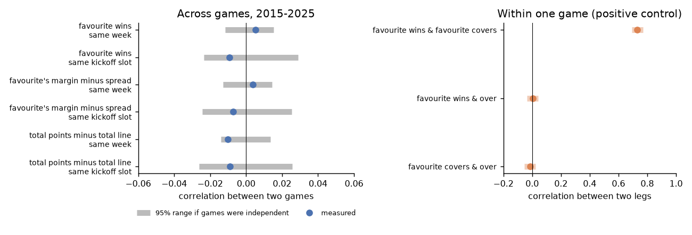
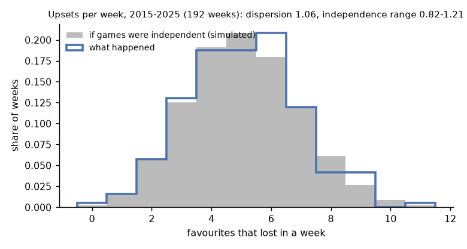
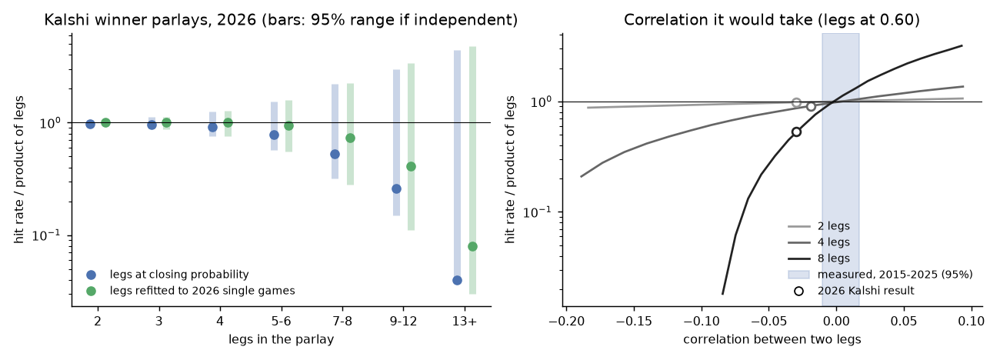

# Are parlay legs independent?

A cross-game parlay is priced as the product of its legs. That is right only if one game's result tells you nothing about another's. We test this on 2,890 NFL games (2015–2025) and 629,434 Kalshi winner parlays (2026, weeks 1–7).

## Answer

- **Across games: yes.** No test finds a link between games. The largest link the data allows would move a two-leg parlay by under half a cent.
- **Within a game: no, and the tests detect it.** "Favourite wins" and "favourite covers" have a correlation of 0.73. Pricing them as a product is 16 cents too cheap.
- **Kalshi 2026 long parlays hit less than the product, but not because of dependence.** Every leg count up to 12 falls inside the range independence predicts; 13+ legs is just outside. Explaining the gap would take a correlation 2–3 times beyond what history allows, and of the opposite sign to the usual story of "upset weeks".

## Method

The tests compare each game's **surprise**: the outcome minus the closing-line expectation. For example, a favourite priced at 80% that wins has a surprise of +0.20. If games are independent, surprises in different games are unrelated.

Each test's "range if independent" comes from simulation or shuffling, not a textbook formula. Pairs of games in one week share games, so the textbook formula understates the uncertainty.

## 1. Do surprises in different games move together?

We correlate the surprises of every pair of games in the same week, and in the same kickoff slot. For the null, we shuffle games across weeks within a season 2,000 times.

| Surprise | Same week | Range if independent | Same kickoff slot | Range if independent |
|---|---|---|---|---|
| Favourite wins | +0.005 | −0.012 to +0.015 | −0.009 | −0.024 to +0.029 |
| Favourite's margin − spread | +0.004 | −0.013 to +0.014 | −0.007 | −0.025 to +0.026 |
| Total points − total line | −0.010 | −0.014 to +0.014 | −0.009 | −0.026 to +0.026 |

All six correlations are inside the range (p = 0.15 to 0.60). For contrast, within one game, "favourite wins" and "favourite covers" correlate at **0.73**, and "favourite wins" and "over" at 0.00.



## 2. Do upsets come in bunches?

If upsets bunched, some weeks would have far more of them and others far fewer than independence predicts. We count the favourites that lost each week and compare the week-to-week variance with 2,000 simulated independent seasons. A ratio of 1 means independent.

| Weekly count, 2015–2025 (192 weeks) | Ratio | Range if independent |
|---|---|---|
| Favourites that lost | 1.06 | 0.82 – 1.21 |
| Favourites that failed to cover | 0.90 | 0.82 – 1.21 |
| Games that went over | 1.01 | 0.82 – 1.20 |



## 3. Two-leg parlays against what happened (2015–2025)

| Parlay | Pairs | Price (product) | Hit | Gap (¢), 95% |
|---|---|---|---|---|
| Favourite A wins & favourite B wins | 20,268 | 43.9% | 44.0% | +0.2 (−2.1, +2.6) |
| Favourite A covers & favourite B covers | 19,414 | 24.9% | 23.4% | −1.5 (−3.2, +0.2) |
| Game A over & game B over | 20,053 | 25.0% | 23.9% | −1.1 (−3.0, +0.6) |
| **Same game:** favourite wins & covers | 2,807 | 33.0% | 48.7% | **+15.7 (+13.9, +17.5)** |
| Same game: favourite wins & over | 2,855 | 33.1% | 32.5% | −0.6 (−2.3, +1.1) |

The intervals come from resampling whole weeks. The small cover and over gaps come from the single legs, not from the pairing. Over the period, favourites covered 48.6% of the time against 49.9% priced, and overs hit 48.9% against 50.0%. Squaring those single-leg rates reproduces the pair hit rates.

## 4. Kalshi 2026: why did long parlays hit less often?

We take each parlay bought before kickoff and compare its hit rate with the product of its legs' closing probabilities. Then we simulate the 106 games 1,000 times as independent to get the range that independence allows. In the second run, each game's probability is refitted to how 2026 single games went. Favourites were priced at 64.7% and won 63.2% of the time.

| Legs | Parlays | Hit | Product | Hit / product | Range if independent | Refitted legs: hit / product |
|---|---|---|---|---|---|---|
| 2 | 6,254 | 25.9% | 26.3% | 0.98 | 0.95 – 1.05 | 1.00 |
| 4 | 52,693 | 8.0% | 8.8% | 0.91 | 0.76 – 1.25 | 1.00 |
| 7–8 | 119,652 | 1.24% | 2.36% | 0.53 | 0.32 – 2.20 | 0.73 |
| 9–12 | 177,683 | 0.18% | 0.70% | 0.26 | 0.15 – 2.99 | 0.41 |
| 13+ | 76,241 | 0.004% | 0.09% | 0.04 | 0.04 – 4.43 | 0.08 |

Every leg count up to 12 falls inside its range. The 13+ bucket is just outside: a result this low has a 1.7% chance under independence, rising to 7% with refitted legs. With refitted legs, 2–4 leg parlays match exactly.

The ranges are wide because 629k parlays are built from only 106 games. One upset changes thousands of parlays at once, so 2026 alone cannot settle the question. The 2015–2025 history can.



The right panel asks how much correlation between legs it would take to produce the 2026 gap. The answer is −0.02 to −0.03, while history allows −0.010 to +0.017. The sign matters too: "upset weeks", where favourites lose together, are a *positive* correlation. That would make favourite parlays hit *more* often than the product, not less.

## Limits

- **Leg types:** only winner legs are tested on Kalshi. Spread and total legs are tested only on 2015–2025 sportsbook lines (sections 1–3).
- **Short-shot parlays:** the probabilities are closing lines, so the tests cannot see a link that only shows up in rare outcomes, such as all 12 favourites losing.
- **Fill times:** these are taken from the 28 Oct pull. The fill time is approximated as the creation hour, and this check keeps only parlays created before the first kickoff.

## Reproduce

```bash
python scripts/parlay_independence.py    # about 2 minutes; writes results/ and figures/ here
pytest tests/test_independence.py        # the tests find a planted dependence and pass independent data
```

Code: [`src/pmrisk/independence.py`](../../src/pmrisk/independence.py). The results tables are in [`results/`](results/).
