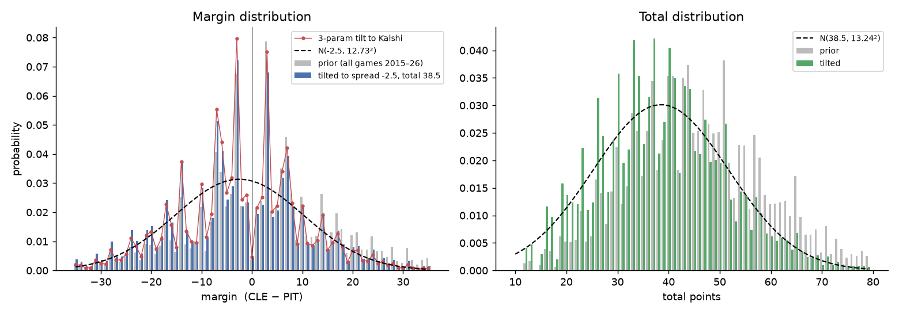
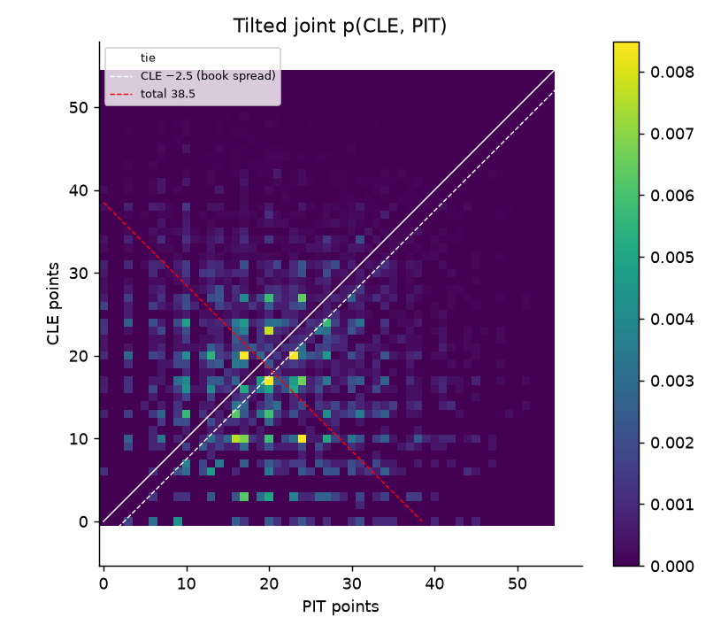
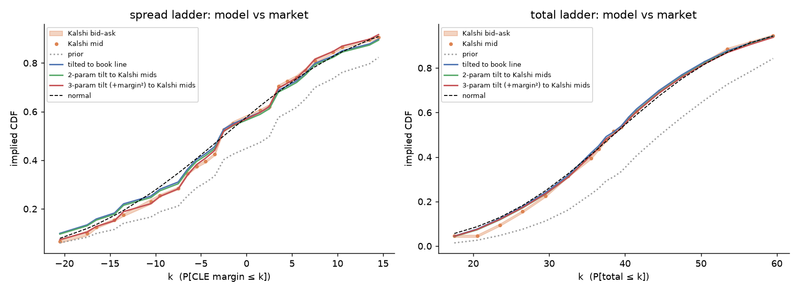
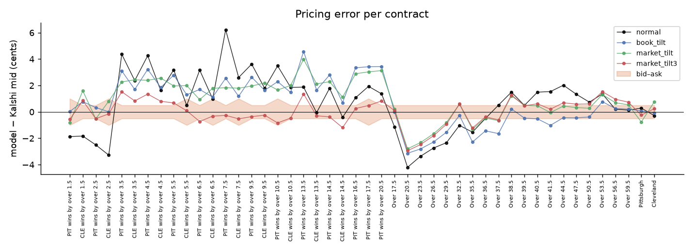

# Toy example: an empirical outcome distribution for one upcoming game

**Game:** Pittsburgh Steelers at Cleveland Browns, Thursday 2026-10-01, 20:15 ET.
**Snapshot:** Kalshi order books captured 2026-09-30 (about 28 hours before kickoff).
**Code:** [`src/pmrisk/score_model.py`](../src/pmrisk/score_model.py) (model), [`scripts/toy_score_model.py`](../scripts/toy_score_model.py) (this example). Outputs in `data/processed/toy_*` and `reports/figures/toy_*.png`.

## 1. The object we are building

Every Kalshi contract on this game is a bet on a region of the final-score grid:

| contract | pays $1 when |
|---|---|
| `Cleveland` (winner) | CLE − PIT > 0 (ties settle at $0.50) |
| `PIT Steelers wins by over 3.5` | CLE − PIT < −3.5 |
| `CLE Browns wins by over 6.5` | CLE − PIT > 6.5 |
| `Over 38.5 points` | CLE + PIT > 38.5 |

Two derived quantities appear throughout:

* **Margin** = CLE points − PIT points (home minus away). Positive: Cleveland won; negative: Pittsburgh won. The winner contract and every spread strike are thresholds on the margin.
* **Total** = CLE points + PIT points. Every total strike is a threshold on it.

The sportsbook's **spread line** (−2.5) is its expected margin, i.e. Pittsburgh favoured by 2.5; its **total line** (38.5) is its expected total.

So if we have one probability table `p(h, a)` over (CLE points, PIT points), the fair price of every contract is a sum of cells. That is the whole design: **build one joint distribution, price everything from it, and hold the exposure vector over the same grid for risk.** We never price a spread and a total with separate models that could disagree.

## 2. Data sources and what each was used for

| source | file | role |
|---|---|---|
| nflverse schedules, 2015–2026 (3,076 completed games) | `data/raw/nflverse_schedules.parquet` | **The prior.** Frequency table of final (home, away) scores. Carries the discrete structure of NFL scoring: key numbers 3/7/10/14, parity between margin and total, common cells like 20–17 and 27–24, the mild widening of the margin at high totals. |
| nflverse closing lines for this game | same file, row `2026_04_PIT_CLE` | **The location targets.** Consensus closing spread (CLE −2.5, i.e. PIT favoured by 2.5) and total (38.5). These are used as the expected margin and expected total of the tilted distribution. |
| Kalshi live order books, 46 contracts | `data/processed/toy_live_quotes_PITCLE.csv` | **The benchmark, and in variants 2b/2c the calibration target.** Best bid/ask and depth for both winner contracts, 25 spread strikes and 19 total strikes, pulled via the authenticated `/markets/{ticker}/orderbook` endpoint. |

Nothing team-specific was used: no ratings, injuries or recent form. The only inputs about *this* game are the two line numbers (and, in the market-calibrated variants, the Kalshi prices). That is deliberate: the point of the toy is to isolate how much of the market's pricing is explained by *NFL score structure plus a location*, before adding any team model.

## 3. Method: exponential tilting of the empirical grid

### 3.1 Prior

Count final scores over all 3,076 games into a 81×81 grid `p₀(h, a)`, home team on the rows. Add a 2% pseudo-count spread proportionally to the product of the two marginal score distributions, so that plausible-but-unseen cells (e.g. 31–33) are not exactly zero. The prior has mean margin +1.9 (home advantage), mean total 45.7, and puts 55% on the home team.

### 3.2 Move the prior to this game with the fewest assumptions

We want a distribution `p` that (i) has the game's expected margin and total, and (ii) is otherwise as close to the prior as possible. Minimising the Kullback–Leibler divergence `KL(p ‖ p₀)` subject to two linear moment constraints gives the exponential-family solution

```
p(h, a) ∝ p₀(h, a) · exp( λ₁·(h − a) + λ₂·(h + a) )
```

with (λ₁, λ₂) solved so that `E[h − a] = −2.5` and `E[h + a] = 38.5`. The solve is a 2-equation root find (`scipy.optimize.root`), instant. For this game λ₁ = −0.0222 and λ₂ = −0.0399: negative λ₁ shifts mass toward Pittsburgh, negative λ₂ toward lower-scoring cells.

Why this and not a parametric model: a Poisson or normal model has to be *taught* about key numbers, parity and cell clustering. The empirical grid already has them, and the tilt only re-weights cells, so it cannot create mass where the prior has none (a 3-point win stays 2.9× as likely as a 4-point win).



Left: grey = prior, blue = tilted to the book line, red = variant 2c below, dashed = the textbook normal. The tilt has moved the centre of mass to Pittsburgh (negative margins) while every spike survives. Right: the total distribution is pulled from 45.7 down to 38.5 while its comb-like structure (totals of 37, 41, 44, 51 are common; 39, 42 less so) is preserved.



The joint table itself. Bright cells are the common final scores; the diagonal is a tie, the dashed white line is the book spread and the red line the total. Each Kalshi contract is a sum over one side of one of these lines.

### 3.3 Three variants of the location step

All three start from the same prior and use the same tilting formula; they differ only in which numbers the tilt is aimed at. "Book" means the sportsbook consensus line is the target and no Kalshi data is used; "market" means the Kalshi mids are the target.

| variant | parameters | fitted to | purpose |
|---|---|---|---|
| **2a book tilt** | λ₁, λ₂ | sportsbook closing spread and total | uses no Kalshi information; tests how much the market can be *predicted* from the book line plus history |
| **2b 2-param market tilt** | λ₁, λ₂ | least squares against the 46 Kalshi mids | reads the market-implied spread and total |
| **2c 3-param market tilt** | λ₁, λ₂, λ₃ on (h−a)² | same | adds a scale parameter so the market can also set the *dispersion* of the margin |

Variant 2b's implied line is CLE −2.22 and total 38.82, a quarter-point from the book on both, which is the Kalshi–book agreement seen in the EDA.

## 4. Results: model prices against the live Kalshi book





Mean absolute error of model price vs Kalshi mid over the 46 contracts (cents):

| model | all | winner | spread strikes | total strikes |
|---|---|---|---|---|
| prior, untilted | 11.2 | 12.5 | 8.7 | 14.3 |
| normal N(line, 12.73² / 13.24²) | 1.89 | 0.28 | 2.32 | 1.48 |
| **2a book tilt** | **1.52** | **0.08** | 1.98 | 1.06 |
| 2b 2-param market tilt | 1.49 | 0.76 | 2.00 | 0.88 |
| **2c 3-param market tilt** | **0.76** | 0.24 | **0.64** | 0.99 |

The quoted bid–ask on these contracts is 1–2¢, so 2c prices essentially the whole board inside the spread.

What the table says:

1. **The location step is most of the work.** Going from the raw prior to the book-tilted grid removes 87% of the pricing error. The winner contract is priced to within 0.1¢ using only the book spread, the total and eleven seasons of scores.
2. **Discreteness matters on the ladder.** The normal model is 2.3¢ off on average on spread strikes and up to 6¢ on a single strike (`PIT wins by over 7.5`), because it smears the mass that the market concentrates on 3 and 7. The book-tilt cuts that to 2¢ with identical inputs.
3. **Two moments are not enough for the tails.** Variant 2a systematically *overprices* Pittsburgh blowouts by 2–4.5¢ (`PIT by over 13.5`: model 22¢, market 17–18¢). The prior's margin has SD 14.2; the market is pricing this low-total game with an SD near 12.3. Matching E[total] lowers scoring but barely tightens the margin. Adding a (h−a)² feature (variant 2c) lets the market set the dispersion and the tail error disappears: spread-strike MAE 0.64¢.
4. **The residual disagreement is in the low-total tail.** All models put 7–8% on a total below 21; the market prices 4.5%. That is 1.5–3¢ on the `Over 20.5`–`Over 29.5` contracts and is the one region where the empirical prior (which includes 2015–2019 low-scoring eras and weather games) may be genuinely miscalibrated for a 2026 dome-era game. Recency weighting or a season drift on totals is the obvious fix.

## 5. What the distribution gives you beyond prices

* **Push and key-number risk.** Under the book tilt, P(CLE loses by exactly 3) = 7.2% and P(loses by exactly 7) = 5.2%. If a spread contract were struck at an integer these would be push probabilities; at half-point strikes they are the probability mass that flips between adjacent strikes (`PIT by over 2.5` vs `over 3.5` differ by 7¢ in the market and 7.2¢ in the model).
* **Exposure vector.** A book of positions is a payoff vector over the same 81×81 grid, so P&L distribution, worst cells and expected shortfall are direct sums. No Monte Carlo is needed pre-game.
* **Conditioning.** `ScoreGrid.condition(mask)` restricts the grid. Restricting to finals with CLE ≥ 10 and PIT ≥ 7 moves P(CLE wins) from 42.4% to 47.7% and E[total] to 42.1. This is the mechanism for in-play pricing, but a real in-play model also needs the clock; the grid alone conditions on the final score, not the state at a point in time. That extension (a scoring-process model per remaining minute, or a state-conditioned empirical table from play-by-play) is the next modelling step.

## 6. Limitations of the toy, in order of importance

1. **No team information.** The distribution around the line is the league-average shape. Two teams with elite defences and a 38.5 total should have a tighter margin than two bad defences at the same total; the market knows this (see result 3) and the toy learns it only by calibrating to the market.
2. **Stationarity of the prior.** Eleven seasons are pooled with equal weight. Scoring environment has moved (season mean totals 43.6–49.5), and rule changes (2015 extra point, 2024 kickoff) alter the key-number mix. Recency weights are a one-line change in `empirical_grid(weights=…)`.
3. **The book line is treated as the mean.** Closing spreads are closer to medians and the margin is skewed; using it as E[margin] introduces a small bias that variant 2b absorbs.
4. **Market calibration uses mids without depth.** Weighting by depth, or fitting to the bid–ask band rather than the mid, would be the proper treatment once a depth history exists.
5. **One game.** The 0.76¢ figure is in-sample for that game. The out-of-sample test is to run 2a on every game in the 2026 archive against the pre-kickoff Kalshi ladders; the EDA's calibration results suggest it will hold, but it has not been run yet.

## 7. Reproduce

```bash
mamba activate nfl
python scripts/toy_score_model.py        # reads the saved Kalshi snapshot; no API call
```

To re-snapshot the order book (needs `.env` credentials), re-run the block in the conversation that produced `data/processed/toy_live_quotes_PITCLE.csv`, or generalise it into a script for any `event_ticker`.
